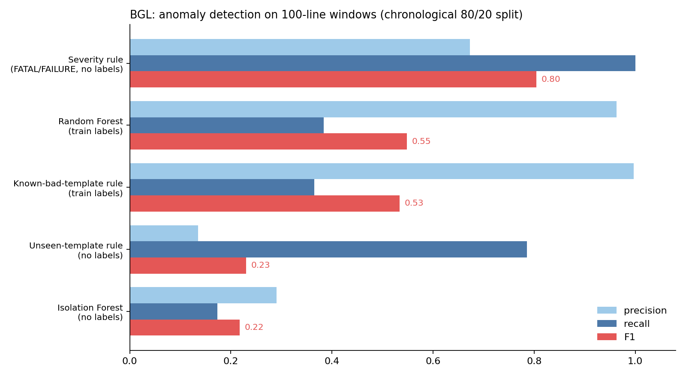
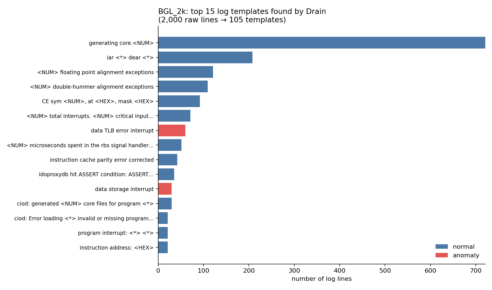

# Log Anomaly Bench

**How well do anomaly detectors really work on system logs, and do they beat a one-line rule?**
A reproducible benchmark of rules, classic ML and (soon) sequence and LLM-based detectors on public supercomputer logs.

## Headline results (BGL, 4.7M lines, chronological split)



| Method | Labels used | Precision | Recall | F1 |
|---|---|---|---|---|
| Severity rule (`FATAL`/`FAILURE` in window) | none | 0.673 | **1.000** | **0.804** |
| Random Forest (template counts) | train | 0.963 | 0.383 | 0.548 |
| Known-bad-template rule | train | 0.997 | 0.365 | 0.534 |
| Unseen-template rule | none | 0.135 | 0.785 | 0.230 |
| Isolation Forest (template counts) | none | 0.290 | 0.174 | 0.217 |

*100-line windows · 47,480 windows · first 80% for training, last 20% for testing (no shuffling, so the models never see the future).*

### What the numbers say
1. **A one-line rule beats every model.** Flagging windows that contain a `FATAL` or `FAILURE` line catches every anomaly (recall 1.0). 99.9% of labelled anomalies are `FATAL` lines. Its weakness is precision: 4.6% of *normal* lines are also `FATAL`.
2. **Supervised models hit a wall at ~37% recall, because of concept drift.** 67% of anomalous lines in the test period come from templates **never seen during training** (e.g. a new `ciod: Error reading message prefix on CioStream socket` failure). A model trained on the past cannot recognise a failure mode that did not exist yet.
3. **Isolation Forest on template counts does poorly (F1 0.22).** "Unusual" windows are not the same as "faulty" windows: rare but harmless templates look just as unusual.

**Takeaway:** on BGL, severity metadata carries most of the signal. A useful detector must beat that rule on *precision* while also handling *new* failure types. That is what the sequence and LLM-based stages will test.

## Data
[Loghub](https://github.com/logpai/loghub) (Zhu et al., ISSRE 2023). **BGL**: 4,747,963 lines from the BlueGene/L supercomputer at LLNL, 7.3% labelled anomalous by experts.

Drain parses the 4.7M lines into **1,128 templates** in ~35 s (≈136k lines/s on a laptop). One template, `data TLB error interrupt`, accounts for 44% of all anomalies.



## Pipeline
| Stage | Status |
|---|---|
| 1. Download data (`download.py`) | ✅ |
| 2. Parse raw logs into templates with Drain (`parse.py`) | ✅ |
| 3. Windows and bag-of-templates features (`features.py`) | ✅ |
| 4. Rules, Isolation Forest, Random Forest (`benchmark.py`) | ✅ |
| 5. Sequence model (LSTM / DeepLog-style next-template prediction) | ⏳ |
| 6. LLM-based detector + cost per million lines | ⏳ |
| 7. HDFS dataset as a second benchmark | ⏳ |
| 8. Docker: one-command reproduction | ⏳ |

## Reproduce
```bash
python -m venv .venv
.venv\Scripts\activate          # Windows  (Linux/macOS: source .venv/bin/activate)
pip install -r requirements.txt && pip install -e .
python -m loganomaly.download --dataset BGL       # 57 MB download, 4.7M lines
python -m loganomaly.parse --dataset BGL          # ~35 s
python -m loganomaly.benchmark --dataset BGL --window 100
python -m loganomaly.plots benchmark --dataset BGL --window 100
pytest
```
Use `--dataset BGL_2k` for a 2,000-line sample that runs in about a second.

## Layout
```
src/loganomaly/   download, parse, features, benchmark, plots
tests/            unit tests (windowing, labels, Drain masking)
results/          metrics (CSV) and charts
data/             downloaded and parsed logs (not committed)
```

## Author
Hamza Fakhri, Computer Science engineering student, Polytech Nantes.
